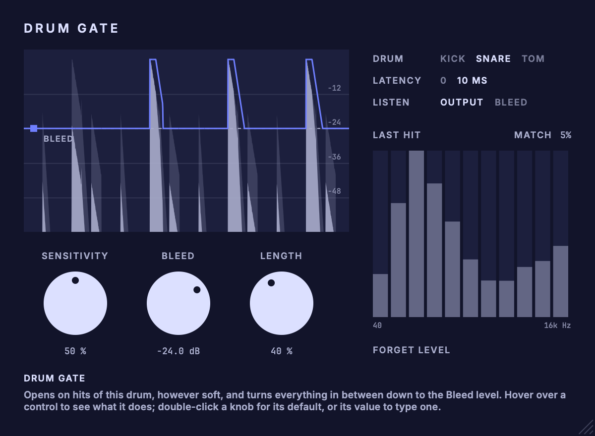

# Drum Gate

A gate for close-mic kick, snare and tom tracks that tries to keep soft hits and ghost notes while turning bleed down.<br>
Part of the codycodie plug-in collection.

Drum Gate follows the level in an 11-band filterbank against a lagging background and treats a rise across the bands as an onset. Loud hits open the gate by level, measured against the drum's own recent loud hits. Quiet hits cannot be judged by level, because a ghost note and another drum's bleed arrive equally loud, so on kick and snare a small logistic-regression classifier (38 features of the hit's first 8 ms) decides whether the hit is probably this drum. Toms use level-based decisions only. The gate never mutes: it moves between 0 dB and the Bleed level, opens the whole spectrum on a hit, then closes the part above the drum's fundamental quickly and lets the body ring for Length. The filterbank, split frequencies and classifier thresholds are values chosen for this plug-in, not measurements of any hardware.



Drum Gate is an independent plug-in identity (AU and VST3). Its bundle identifier is `com.c0dypeng.drumgate`, its manufacturer code is `Cdpg` and its plug-in code is `Drgt`.

## Downloads

Get the latest packages from the [Drum Gate releases page](https://github.com/chijenpeng/drum-gate/releases/latest). The macOS release contains Universal AU and VST3 bundles for Apple Silicon and Intel. The Windows release contains a native x64 VST3. macOS bundles are ad-hoc signed and are not notarized; the Windows plug-in is unsigned.

## Controls

| Control | What it does |
|---|---|
| Sensitivity | How readily a quiet hit opens the gate (0 to 100 %, default 50 %). Loud hits always do. |
| Bleed | Gain applied between hits (-80 to 0 dB, default -24 dB). 0 dB leaves the track untouched; lower is tighter. Also the dashed line in the display, which can be dragged. |
| Length | How long the drum rings on after each hit (0 to 100 %, default 40 %). |
| Drum | Kick, snare or tom. |
| Latency | Tracking (0 ms) or Mix (10 ms). Mix hears each hit out first and opens ahead of it. |
| Listen | Output, or the bleed being removed. |
| Forget level | The gate learns how loud the drum is as it plays and saves that with the session. Use this after changing the track's gain or the drum. |

Hovering over a control explains it in the bottom-left corner of the editor.

## Limits

- In the 0 ms Tracking mode every onset opens the gate provisionally for up to 8 ms before bleed is shut out again.
- Latency is either 0 ms or 10 ms.
- Toms use level-based decisions; the classifier was no better than chance on toms. Toms may do worse than behind a well-set conventional gate.
- The classifiers were trained on a small set of rock and metal kits. On other kits and playing styles they can do worse than a conventional gate; on a jazz kit played with brushes the snare does.
- Tail handling has not been judged by ear, and no DAW-host test has been run.

## Build

The project requires CMake 3.22 or later and a C++17 compiler. For AU and VST3 builds, use macOS 11 or later; the Windows VST3 release uses native x64 MSVC from Visual Studio 2022. It uses JUCE 8.0.9. Put a local checkout at `third_party/JUCE` to avoid a fetch; otherwise CMake downloads that tagged release while configuring.

```sh
cmake -S . -B build -G Ninja -DCMAKE_BUILD_TYPE=Release
cmake --build build -j2
ctest --test-dir build --output-on-failure
```

On Windows, configure with `cmake -S . -B build -G "Visual Studio 17 2022" -A x64 -DCOPY_PLUGIN_AFTER_BUILD=OFF`, then build with `cmake --build build --config Release --parallel 2` and test with `ctest --test-dir build -C Release --output-on-failure`.

Plug-in copying is disabled by default, so builds stay in the build tree and do not touch installed plug-ins. To copy the bundles into the current user's Audio Plug-Ins folders, configure with `-DCOPY_PLUGIN_AFTER_BUILD=ON`. Build products remain under `build/DrumGate_artefacts/Release`.

## Validation and snapshots

The only registered test, `drumgate_snapshot_renders`, runs the processor on a synthetic scene, constructs the editor and renders it to a PNG; it fails if the image cannot be written. It does not measure detection quality. The same tool renders the maintained editor image:

```sh
cmake --build build --target drumgate_snapshot
./build/drumgate_snapshot_artefacts/Release/drumgate_snapshot docs/editor.png
```

The macOS package is built with `tools/package_macos.sh`, which checks bundle identity, architectures, signatures and archive integrity.
